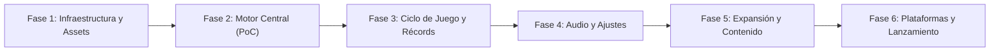

# Roadmap — untitledTecGame

Visión estratégica y plan por fases para el desarrollo y migración del juego arcade a Flutter + Flame.

---

## Visión del Producto

Evolucionar el prototipo original hacia una **implementación de videojuego arcade 2D completa, escalable y comercialmente viable** en Flutter + Flame. Aunque el proyecto nació como un taller formativo, el objetivo actual es consolidar un título robusto con mecánicas de combate completas, variedad de naves, progresión de dificultad, sistema de audio inmersivo y soporte multiplataforma de primera clase (Móvil, Web y Escritorio).

---

## Fases del Roadmap

### Fase 1: Infraestructura y Preparación (En curso)
- **Hito**: Proyecto libre de conflictos de dependencias con todos los assets base listos en `assets/images/`.
- [x] Auditoría de descubrimiento de `GameCoronaTec` y definición de arquitectura.
- [x] Configuración de OpenSpec y políticas de flujo (`docs/`, `openspec/`).
- [ ] Resolución de conflicto `intl` con `flutter_localizations`.
- [ ] Importación de spritesheets `character1.png` (64x64) y `effects_skills.png` (34x34).

### Fase 2: Motor Central y PoC Jugable
- **Hito**: Prototipo funcional donde la nave se mueve con el dedo, dispara láseres y destruye asteroides con colisiones precisas.
- [ ] Implementación de `PlayerComponent` con animaciones (`left`, `right`, `shot`).
- [ ] Sistema de generación perimétrica de asteroides con trayectorias e impulsos aleatorios.
- [ ] Componente `LaserComponent` y colisiones reactivas con `flame/collisions.dart`.
- [ ] Acumulación básica de puntaje en partida.

### Fase 3: Ciclo de Juego, HUD y Récords
- **Hito**: Juego completo con flujo de vidas, muerte, fin de partida y registro de mejores puntajes.
- [ ] Manejo de 3 vidas con invulnerabilidad temporal y parpadeo visual.
- [ ] HUD en tiempo real implementado como Flutter Overlay sobre el `GameWidget`.
- [ ] Flujo de Game Over y transición a pantalla de resultados.
- [ ] Persistencia y ordenamiento del Top 10 en `PersistentData` conectado a `ScoreMenuPage`.

### Fase 4: Audio y Ajustes de Usuario
- **Hito**: Experiencia audiovisual inmersiva con música y efectos controlables desde la configuración.
- [ ] Generación/adquisición de efectos de sonido (disparo, daño, explosión, reaparición, fin de partida).
- [ ] Implementación del servicio `AudioManager` usando `flame_audio`.
- [ ] Conexión de controles de volumen y silenciado con `ConfigurationPage`.

### Fase 5: Expansión de Jugabilidad y Contenido
- **Hito**: Juego enriquecido con rejugabilidad, selección de naves y nuevos desafíos.
- [ ] Integración de naves jugables adicionales (`character2.png` y `metalshark.png`) con características propias de velocidad y cadencia.
- [ ] Tipos variados de obstáculos/enemigos (asteroides gigantes que se fragmentan, naves enemigas con trayectoria hostil).
- [ ] Sistema de power-ups temporales (disparo triple, escudo de energía, ralentización temporal).
- [ ] Curva de dificultad dinámica por oleadas y jefes de nivel periódicos.

### Fase 6: Multiplataforma y Lanzamiento
- **Hito**: Compilación estable y optimizada para Android, iOS, Web y Escritorio.
- [ ] Soporte de controles híbridos (táctil para móviles, teclado/mouse para Web y Gamepad Bluetooth).
- [ ] Optimización de rendimiento a 60/120 FPS y pruebas de perfiles de memoria.
- [ ] Generación de iconos nativos (`flutter_launcher_icons`) y splash screen (`flutter_native_splash`).
- [ ] Pipeline de CI/CD para compilación de binarios.
